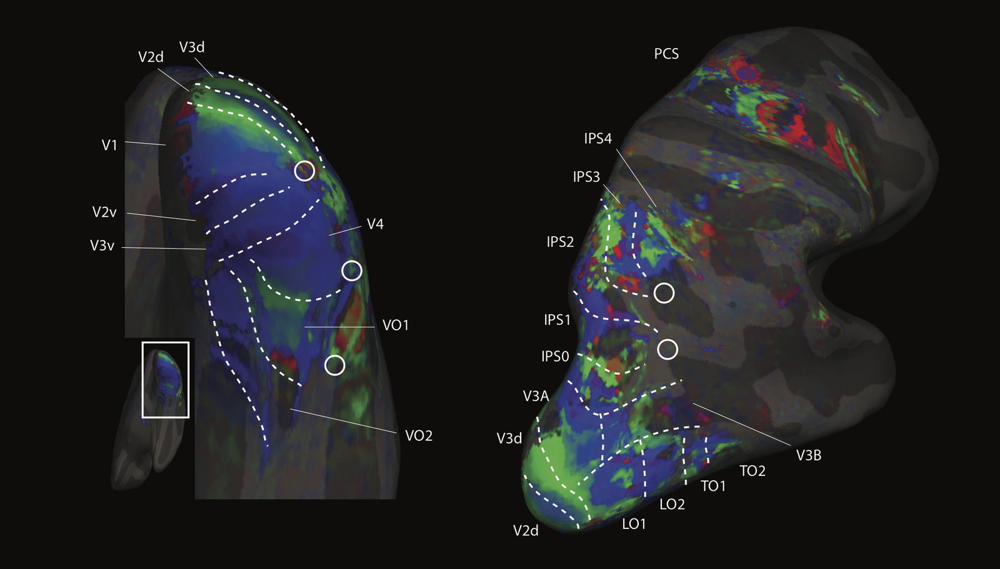

Martin Szinte, now a Post-Doc in Heiner Deubel's lab in Munich, will start as a Post-Doc in the lab, after winning a prestigious Marie Curie grant.

From around summer 2016, Martin will use MRI-derived forward models to investigate human eye movement planning and visual stability.  

