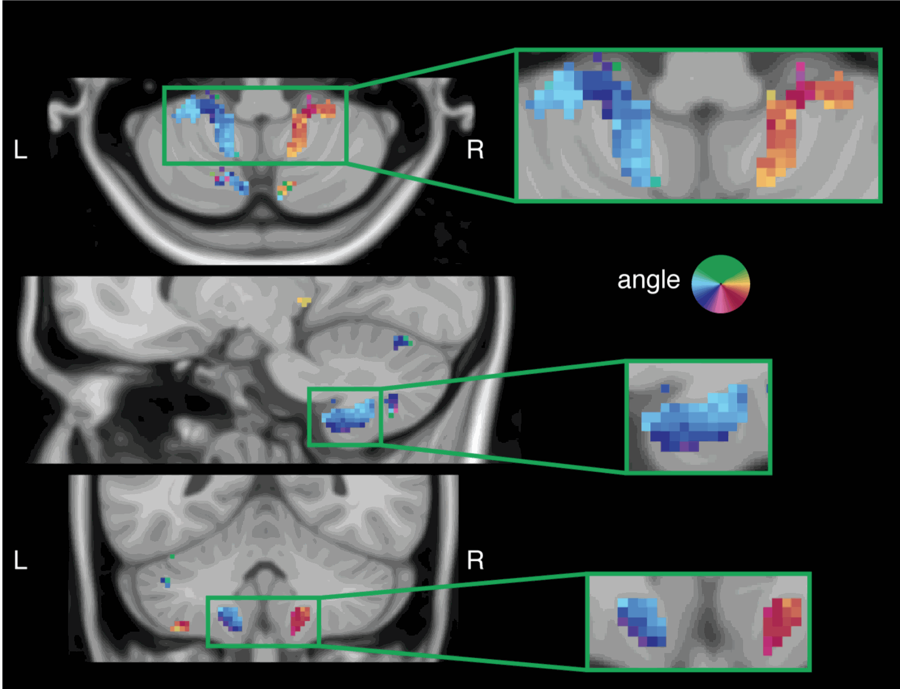

"<a href="https://www.biorxiv.org/content/early/2018/10/29/455170" target="_blank" alt="Retinotopic maps of visual space in the human cerebellum" >Retinotopic maps of visual space in the human cerebellum</a>". 

D.M. van Es, W. van der Zwaag, T. Knapen

The published version is on the [publication page](/publications/2019-05-20-CB/).

**New preprint on Biorxiv:** While the cerebellum is instrumental for motor control, it is not traditionally implicated in vision. Here, we report the existence of 5 ipsilateral visual field maps in the human cerebellum. These maps are located within the oculomotor vermis and cerebellar nodes of the dorsal attention and visual networks. These findings imply that the cerebellum is closely involved in visuospatial cognition, and that its contributions are anchored in sensory coordinates.