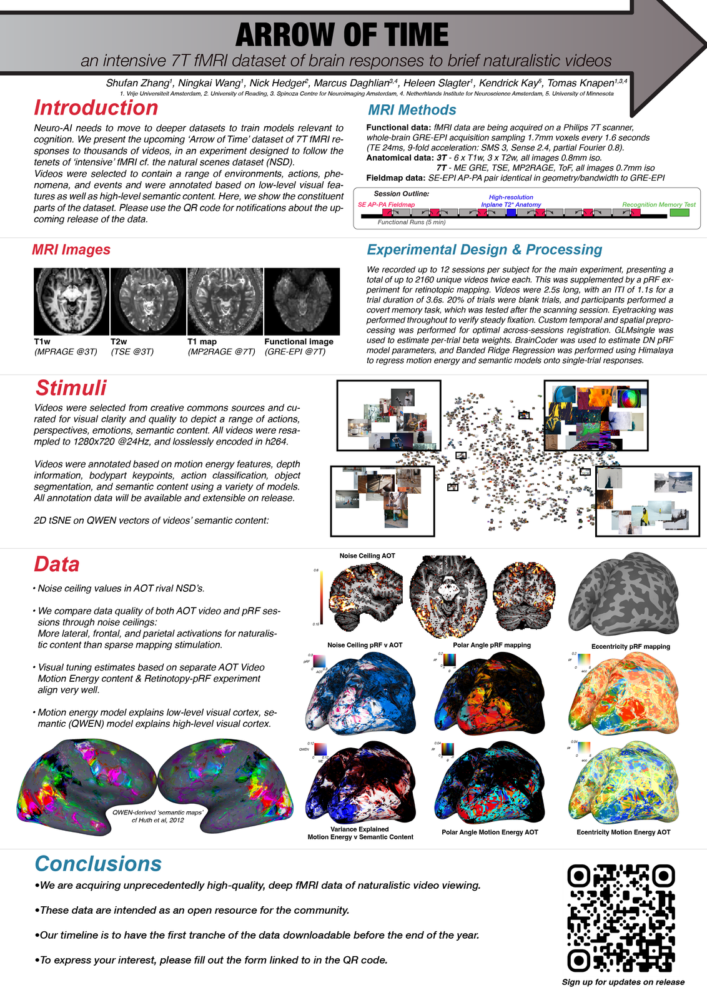

**Update, November 2026:** The first release of Arrow of Time is planned around the turn of the year. To be notified when it is available, please fill in the [sign-up form](https://forms.gle/BMmfyWEZKL7vU5Va9).

We are in the final stretch of data collection for **Arrow of Time (AOT)**, an intensive 7T fMRI dataset of brain responses to brief naturalistic videos. Over the past year we have been scanning participants on our Philips 7T, and we are now working through the last few subjects on the roster.

Each participant contributes 15 hours of 7T fMRI at 1.7mm isotropic resolution (TR 1.6 s, SMS 3), viewing 2160 short, creative-commons video clips selected to span a wide range of natural scene and motion statistics. Alongside the main video experiment, every subject also completes separate retinotopy and video motion-energy localizer runs, giving the dataset a rich set of functional anchors per individual.

Early looks at the data are encouraging: noise ceilings across visual cortex are high, the motion-energy and retinotopic maps are crisp, and single-subject semantic structure is already visible in the video-evoked responses. These are exactly the properties we were hoping for when we designed the protocol.

The plan remains to release AOT as an open resource for the community, with a public, downloadable first release (see the update above). If you would like to be notified when the dataset goes live, please fill in [the sign-up form](https://forms.gle/BMmfyWEZKL7vU5Va9). We will keep that list updated as we finalize the release.

More details, including a proper data paper, will follow once scanning wraps.
