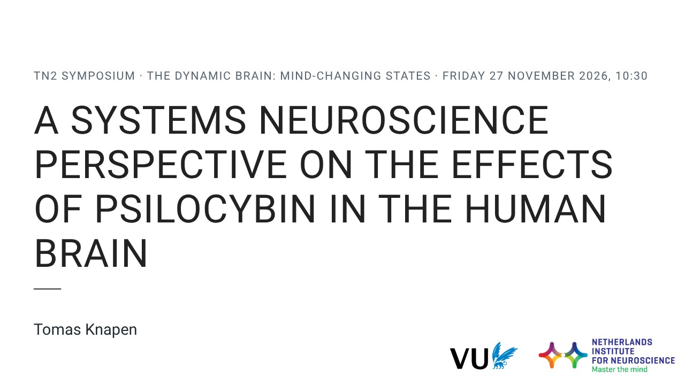

On 27 November 2026, Tomas Knapen gave a keynote at the symposium of the [Translational Neuroscience Network (TN2)](https://tn2.eu/) in Amsterdam, "The dynamic brain: mind-changing states". The talk was called "A systems neuroscience perspective on the effects of psilocybin in the human brain".

<a class="button" href="/talks/tn2-psilocybin/">Open the slides</a>

The slides run in the browser, with their animations. Step through them with the arrow keys or the space bar, replay a clip with R, and press F for full screen.

The talk follows one computation, [divisive normalization](/research/computational-models/), from the receptive field of a single voxel to perception. Surround suppression in visual cortex varies with the density of serotonin receptors ([Aqil et al., 2024](/publications/2024-01-03-SA/)). In a double-blind study with three doses, psilocybin weakened surround suppression in early visual cortex while the visual field maps stayed in place, and the same change showed in perception as a stronger Ebbinghaus illusion ([Aqil et al., 2025](/publications/2025-11-21-NC/)). The second half turns to the body as context for vision: the body maps in visual cortex ([Hedger et al., 2025](/publications/2025-11-26-NAT/)), and the next step, measuring them under psilocybin in the [project funded by the Tiny Blue Dot Foundation](/2026/11/10/tiny-blue-dot.html).

The deck was built with [lecturekit](/animations/). We plan to post the slides of more talks in the same way.
